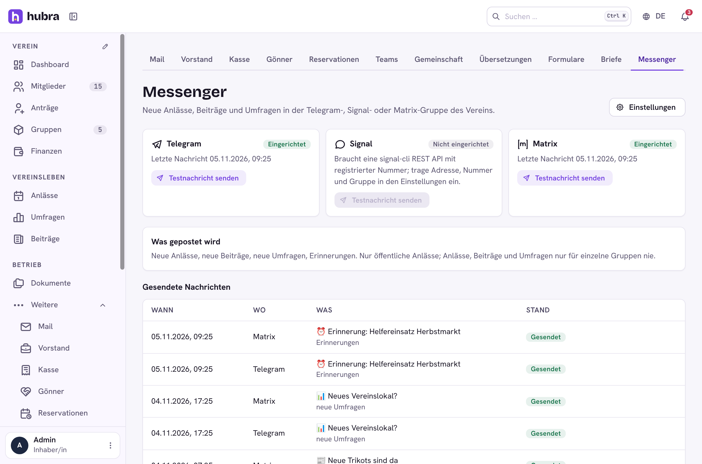

# Messengers

[](https://github.com/hubra-app/hubra-plugin-messengers/actions/workflows/release.yml?query=branch%3Amain) [](https://github.com/hubra-app/hubra-plugin-messengers/releases/latest) [](LICENSE)

A plugin for [Hubra](https://hubra.club). Announcements in the club's Telegram, Signal or Matrix group: new events, posts and polls, and reminders before an event or before a poll closes.

**Version** 1.0.0 · **Works with** Hubra >=0.2,<1 · **Plugin id** `messengers` · **Needs** the members module



## What it does

- **One plugin, three messengers.** Each one is set up in the module's settings and works on its own:
  - **Telegram:** a bot from @BotFather, added to the club's group or channel; enter its token and the chat (`@channel` or the `-100…` chat ID).
  - **Signal:** Signal has no bot API, so the club runs [signal-cli-rest-api](https://github.com/bbernhard/signal-cli-rest-api) with a registered number; enter its https address, the number, the group (`group.…`) and, if it has one, a token.
  - **Matrix:** the homeserver, an access token of the club's account and the room ID (the account must be in the room).
- **What is posted.** Switches for new events, posts, polls and reminders. Messenger groups may be open to anyone, so only what the whole club may see goes out: public events (members-only events too, if the club switches that on), and never an event, post or poll meant for some groups only. An event published twice is announced once.
- **Reliable.** Hubra sends after the change is saved, in the background. A message that fails is tried again every minute, three times in all. The page shows what went where, the last failure per messenger, and lets the board send a test message or try a failed one again.
- **Safe addresses.** Signal and Matrix addresses come from the club, so Hubra calls them only over https, follows no redirects and refuses hosts that resolve to private networks. A platform that runs signal-cli next to Hubra allows it by name with `MESSENGERS_PRIVATE_HOSTS=signal-api` (comma-separated). Tokens are stored encrypted and never shown in errors.

The page needs the permission `messengers.channels.update`. WhatsApp is left out: it only works through Meta's paid business API.

## Install

Platform admins install it from the Plugin catalogue in manage
(official Marketplace, <https://plugins.hubra.club/index.json>, signed with
the Hubra project key). Clubs then switch it on under Einstellungen → Module.

## Develop

Clone this repository into `plugins/messengers` of a Hubra checkout. Its tests
then run with Hubra's (`cd app/backend && pytest ../../plugins/messengers`), and
`npm run build:plugin` in `app/frontend` builds its frontend. The workflow
does the same against Hubra's `main` on every push and pull request.

## Releasing

Bump `version` in `plugin.yaml`, add a `## <version>` section to
`CHANGELOG.md` and merge. Then tag the merged commit on main and push the tag:

```sh
git switch main && git pull
git tag v<version> && git push origin v<version>
```

The workflow tests the plugin and builds its frontend, the `plugin-signing`
job signs it after your approval, and only then is the GitHub release
`v<version>` published, with `messengers-<version>.zip` and its `.sha256` attached.
Files listed in `.releaseignore` stay out of the zip. Releases are immutable,
so a published version never changes: fix a bad one with a new version.

Source: <https://github.com/hubra-app/hubra-plugin-messengers>
